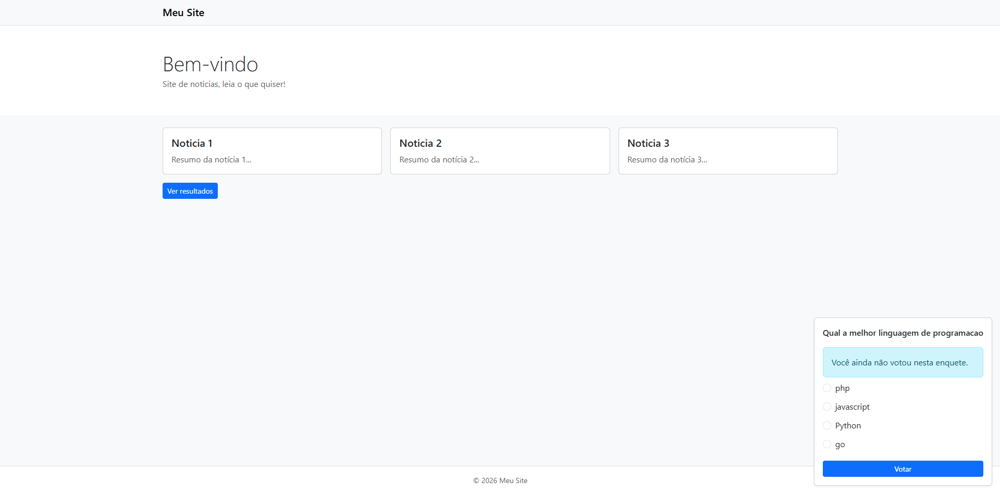
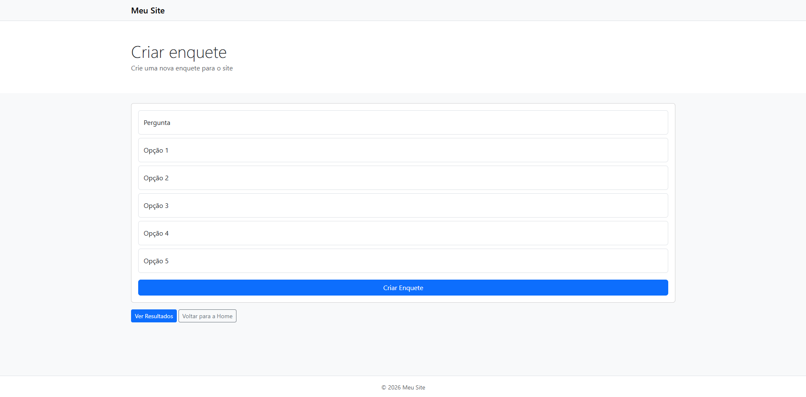
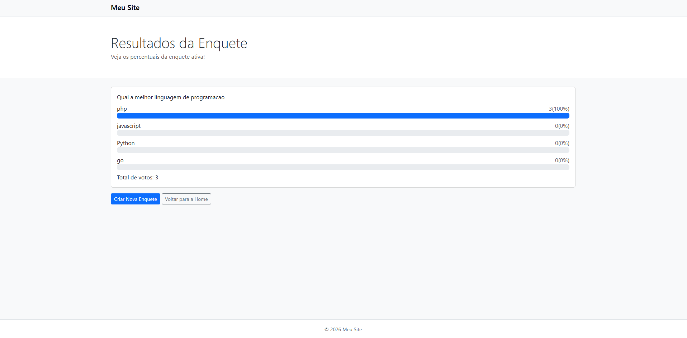
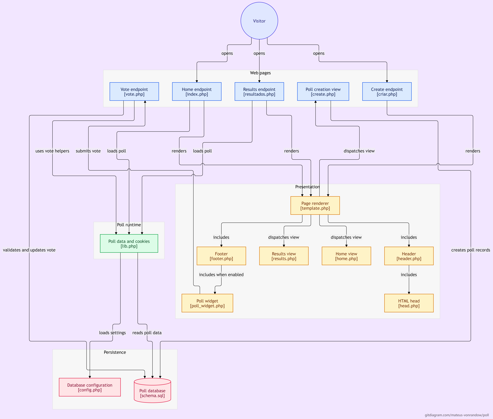

# Poll — Sistema de Enquetes

Aplicação web desenvolvida em PHP para criação de enquetes, registro de votos e visualização de resultados em tempo real a partir dos dados armazenados no banco de dados.

## Funcionalidades

- **Criação de enquetes:** cadastro de uma pergunta com pelo menos duas opções de resposta.
- **Enquete ativa:** a enquete criada passa a ser automaticamente a enquete exibida pelo sistema.
- **Sistema de votação:** registro dos votos associados às opções da enquete ativa.
- **Visualização de resultados:** exibição da quantidade de votos, percentual por opção e total de votos, com barras de progresso.
- **Controle de votos por cookies:** utiliza cookies para limitar novas votações na mesma enquete pelo navegador.
- **Persistência de dados:** armazenamento das enquetes, opções, votos e configurações no banco de dados.

## Screenshots

### Página inicial



### Criação de enquetes



### Resultados



## Diagrama



## Tecnologias utilizadas

- PHP
- MySQL
- PDO (PHP Data Objects)
- SQL
- HTML
- Bootstrap
- CSS

## Estrutura do projeto

```text
poll/
├── partials/
│   ├── header.php
│   └── footer.php
├── views/
│   ├── create.php
│   ├── home.php
│   └── results.php
├── config.php
├── criar.php
├── index.php
├── lib.php
├── resultados.php
├── schema.sql
├── template.php
└── vote.php
```

## Banco de dados

O arquivo `schema.sql` define três tabelas principais:

- `polls`: armazena as perguntas e a data de criação das enquetes.
- `poll_options`: armazena as opções de resposta e a quantidade de votos de cada uma.
- `settings`: identifica qual enquete está ativa no sistema.

## Objetivo do projeto

Este projeto foi desenvolvido com o objetivo de praticar conceitos de desenvolvimento web backend, integração entre PHP e MySQL, manipulação de dados com PDO, processamento de formulários e organização de código em componentes reutilizáveis.

## Autor

**Mateus von Randow**

[GitHub](https://github.com/Mateus-vonRandow)

---

Desenvolvido como projeto prático de aprendizado em desenvolvimento web.
